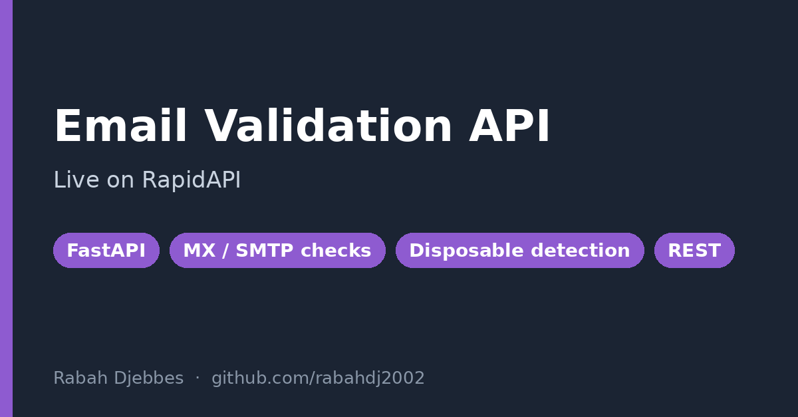

# Email Validation API 🚀

[](https://github.com/rabahdj2002/Email-Validation-API/actions/workflows/ci.yml)
[](https://fastapi.tiangolo.com)
[](https://rapidapi.com/rabahdjebbes6-VpFXFzqdF1R/api/email-validation-api32)
[](LICENSE)



**A production email validation API that checks syntax, MX records, SMTP deliverability and disposable domains, and returns a confidence score.**
Use it to block fake and throwaway sign-ups, clean mailing lists and reduce bounce rates.

## 🔗 Live

- 🌐 **Website**: https://verify-mail.rabahdj.online
- 📖 **Interactive docs (Swagger)**: https://verify-mail.rabahdj.online/docs
- 🏪 **RapidAPI**: https://rapidapi.com/rabahdjebbes6-VpFXFzqdF1R/api/email-validation-api32

## ✨ Checks

| Check | What it does | Score |
|---|---|---|
| Syntax | Validates the address format | +0.4 |
| MX records | Confirms the domain can receive email (DNS lookup) | +0.4 |
| SMTP (`full` mode) | Asks the mail server whether the mailbox exists | +0.2 |
| Disposable | Flags known throwaway domains (Mailinator, YOPmail, …) | score set to 0 |

An address is `valid` when its score is **≥ 0.6**. If the mail server rejects the mailbox (5xx), the score is capped at 0.4. If no mail server can be reached on port 25 (many cloud hosts block it), `smtp` is `"unavailable"` and the basic score stands.

`suggestion` proposes a fix for common domain typos, e.g. `ana@gmial.com` → `gmail.com`.

## 📡 Usage

**`POST /validate`**

```bash
curl -X POST https://verify-mail.rabahdj.online/validate \
  -H "Content-Type: application/json" \
  -d '{"email": "john@example.com", "depth": "full"}'
```

`depth` is `basic` (syntax + MX + disposable, fast) or `full` (adds the SMTP check).

**Response**

```json
{
  "valid": true,
  "score": 1.0,
  "checks": {
    "syntax": true,
    "mx": ["mx1.example.com"],
    "smtp": "250",
    "disposable": false
  },
  "suggestion": null
}
```

**`GET /ping`** returns service status and version.

## 🛠️ Run locally

```bash
pip install -r requirements.txt
python main.py            # serves on http://localhost:8001
```

Open http://localhost:8001/docs for the interactive API docs.

Or with Docker:

```bash
docker build -t email-validation-api .
docker run -p 8001:8001 email-validation-api
```

## 🧪 Tests

The tests cover scoring, every check, SMTP fallback across MX hosts, DNS failures, input validation and typo suggestions. DNS and SMTP are mocked, so they run offline. CI runs lint, the tests and a Docker build on every push.

```bash
pip install -r requirements.txt -r requirements-dev.txt
ruff check .
pytest -q
```

## ☁️ Deploy for free

The repo includes a [Render](https://render.com) blueprint (`render.yaml`). On Render, choose **New → Blueprint**, pick this repository and deploy. Health checks use `/ping`, and the port comes from `$PORT`.

| Variable | Default | Purpose |
|---|---|---|
| `PORT` | `8001` | HTTP port |
| `DNS_TIMEOUT_SECONDS` | `3` | MX lookup timeout |
| `SMTP_TIMEOUT_SECONDS` | `10` | Per-server SMTP timeout |
| `SMTP_HELO_HOST` | `email-validation-api.local` | Name used in HELO/MAIL FROM (set to your domain) |

## 🧱 Tech stack

Python · FastAPI · Pydantic · dnspython · smtplib · Uvicorn · pytest · Docker · GitHub Actions

## 👨‍💻 Author

**Rabah Djebbes** – Software & Automation Engineer
[LinkedIn](https://www.linkedin.com/in/rabahdjebbes) · [GitHub](https://github.com/rabahdj2002) · Rabahwork@gmail.com

## 📄 License

MIT – see [LICENSE](LICENSE).
